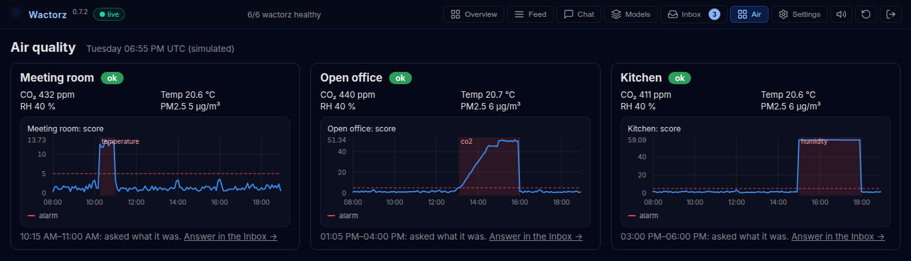
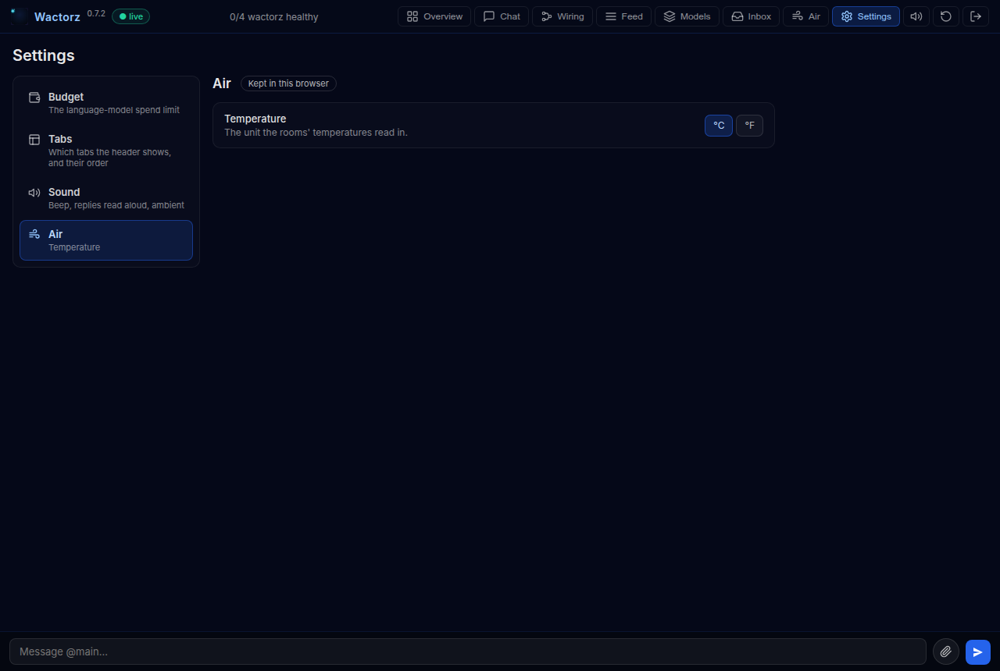

# Room air quality

A model of what each room is usually like at each hour, an agent that notices
when a room is not, and a person asked what it was. Their answers become
labels, which is what a new version of the model is then judged against.

A simulated office stands in for real sensors: three rooms (a meeting room, an
open office and a kitchen), each with CO₂, temperature, humidity and PM2.5, a
reading every five minutes, people in from nine to five. On the Tuesday it
plays, three things go wrong:

| When (UTC) | Where | What |
| --- | --- | --- |
| 10:15–11:00 | Meeting room | a window left open during the meeting |
| 13:00–16:00 | Open office | the ventilation stops |
| 15:00–18:00 | Kitchen | the humidity sensor sticks at 99 % |

No language model and no Home Assistant are needed, and nothing heavier than numpy.

## What is in it

| File | What it does |
| --- | --- |
| `air_quality/plant.py` | the simulated building: the same readings on every run |
| `air_quality/model.py` | what is usual: per room and hour, the mean and spread of each quantity |
| `air_quality/train.py` | fits a healthy week and stores the model, with its threshold in the version's metadata |
| `air_quality/publish.py` | plays the Tuesday onto MQTT |
| `air_quality/agents.py` | `air-detect` scores each reading; `air-watch` asks about each episode |
| `air_quality/recipe.py` | the model as the train step fits it, from recorded readings |
| `air_quality/loop.py` | the recorder, the drift agent, the trainer and the baseline rule, with their options set |
| `air_quality/tab.py`, `panel.js` | the dashboard's Air tab |
| `pyproject.toml` | the entry points that bring the agents, the loop and the tab |

The score of a reading is how many spreads its furthest quantity is from that
hour's usual. That is the idea the example is about: 1200 ppm of CO₂ is
ordinary in a full meeting room at three in the afternoon, and far from normal
at three in the morning, so "normal" is learned per hour, not as one number.

## Run it

From the repository, in the environment Wactorz is installed in:

```bash
pip install -e examples/air_quality

# The model: v1, alarms past 5 spreads, made active.
python -m air_quality.train

# Wactorz, with this package's agents and tab, and no language model.
WACTORZ_EXTENSIONS=wactorz-example-air-quality wactorz --llm none
```

Open the dashboard (`http://localhost:8888`), and the **Air** tab. Then, in a
second terminal, from the same folder:

```bash
python -m air_quality.publish --week --speed 60   # the healthy week, half a minute
python -m air_quality.publish                     # the Tuesday
```

The week is what the model learned from; played first, the recorder holds it,
and the drift agent (below) has something to compare the Tuesday against. The
Tuesday plays 07:00 to 19:00 at one five-minute step a second, about two and a
half minutes. Run `train` and `wactorz` from the same folder: the model is
stored in the state directory Wactorz runs with (`WACTORZ_STATE_DIR`, else
`./state`).

## What to look at



1. **The Air tab.** A card per room: its latest readings, and its score over
   the day with the threshold across it. A room past the threshold for two
   readings in a row turns to *alert*; when it has settled for three, the
   stretch is shaded and the agent asks what it was.
2. **The Inbox.** One question per episode, such as *Meeting room, 10:15–11:00
   UTC: temperature (°C) was far from usual for the hour. What was it?*, with
   Window open, Ventilation fault, Sensor fault and Normal. Answer them; each
   answer is marked on the room's chart.
3. **The labels.** Each answer is now a label on its room over exactly that
   window: `GET /api/labels?source=kitchen`, or the room's history. "Normal" is
   a label too, so a false alarm can be counted as one.
4. **Settings → Air.** The tab has one setting, the unit its temperatures read
   in: `tab.py` declares it, the dashboard draws it, and each browser keeps its
   own choice. The readings, the model and the questions stay in °C.



## A stricter version, on trial

The labels are what a second version is judged against. Store one that alarms
earlier, at 4 spreads, put it on trial beside v1, and say which labels count as
a fault:

```bash
python -m air_quality.train --k-sigma 4 --set shadow
wactorz-artifacts judge air-quality:2 --positive window_open --positive ventilation_fault --positive sensor_fault
```

Play the day again and answer the questions. The **Models** tab
(`#/models/air-quality`) shows both versions on the same readings: the faults
each caught and how soon, and the false alarms. The threshold is in each
version's metadata (`k_sigma`), which the agent reads with
`me.artifacts["model"]["metadata"]`, so a version and the threshold it was
meant for travel together.

## The loop without a person

The package also carries the four library agents that retrain the model on
their own (`loop.py`), started with the system:

| Agent | What it is | What it does here |
| --- | --- | --- |
| `air-recorder` | the `recorder` | files every room's readings under `sensors/air` and the detector's scores under `air/scores`, as Parquet in the state directory |
| `air-drift` | the `drift` agent | every ten seconds, holds the last day of readings and scores against the healthy week the served version learned from: PSI and KS on each quantity and on the scores, and ADWIN for the moment the scores changed |
| `air-trainer` | the `trainer` | fits `recipe.py` on a window of the recorded readings when asked, stores the version, and sets it as shadow when it is no worse than the served one on `false_alarms` |
| `air-retrain` | a rule | the baseline of `docs/design/drift.md`: a drift alarm on the scores sends `air-trainer` a task with `time_split` at the moment the alarm names and the alarm's observation, once a day |

Play the week and the Tuesday as above and watch the feed. The quantities alarm
early and say little: a day's readings held against a week's, nights and
weekend included, look shifted on any busy day, which is why the rule listens
to the scores alone. The scores are what is usual for the hour, so they shift
when a room does: around 15:00 ADWIN finds the ventilation fault, naming a cut
in the early afternoon, `air-retrain` fires, and `air-trainer` fits a new
version on the last week of readings before the cut, scores both versions on
the readings after it, stores v2 and sets it as shadow. From then on `air-detect`
runs both versions on every reading, and the Models tab shows the trial. The
alarms are `GET /api/models/air-quality/drift`; the run, the version it made
and the alarm it followed from are `GET /api/provenance?kind=action` and
`GET /api/provenance/<id>?walk=up`.

What this baseline does not do is the point of the exercise: it asks nobody,
reads no label, retrains on a fixed window cut where the alarm says, and
leaves the promotion to the policy (`PUT /api/models/air-quality/policy`),
which needs the labels your answers in the Inbox make. A controller that does
better with the same alarms, the same step and the same policy, with fewer
retrains and fewer questions, is what the simulator scores it against.

Time in the loop is the readings' own: the drift agent's day ends at the newest
reading recorded, the trainer's week ends there too, the rule's day of cooldown
counts the alarms' times, and a trial's days are the time its pairs cover. The
Tuesday is in March 2026 and plays in minutes; nothing here reads the clock on
the wall to place it.

## Where to go from here

- Real sensors: publish `{"device": <room>, "ts": <seconds>, "co2": ..., "temperature": ...,
  "humidity": ..., "pm25": ...}` on `sensors/air/<room>`, and fit the model on a week of your own:
  `@air-trainer {"since": <seconds>, "until": <seconds>, "reason": "a healthy week"}` once the
  recorder holds it.
- A slower loop: `@catalog spawn air-drift {"check_s": 600}` checks every ten minutes, as the
  `drift` agent does unless told otherwise.
- Home Assistant sensors: a rule or a small agent republishing their states on those topics.
