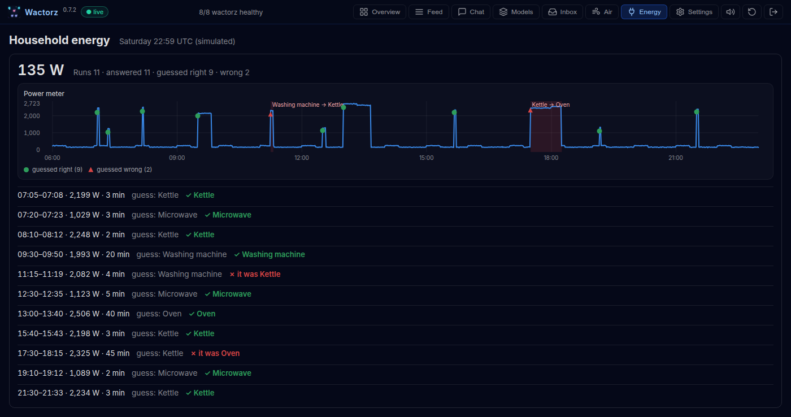

# Household energy

One power meter for the whole house, an agent that finds each time an
appliance ran, a classifier that names it, and a person asked whether it was
right. Their answers become labels, which is what a new version of the
classifier is then judged against.

A simulated house stands in for a real meter: a reading every minute, a fridge
humming in the background, and four appliances that each add their own draw
for as long as they run. On the Saturday it plays, eleven runs:

| Appliance | Draws | Runs for |
| --- | --- | --- |
| Kettle | about 2,200 W | 2–4 minutes |
| Microwave | about 1,100 W | 2–6 minutes |
| Washing machine (heating) | about 2,000 W | 15–25 minutes |
| Oven | about 2,450 W | 30–50 minutes |

Two of them are written to be hard: the kettle at 11:15 draws less than a
kettle usually does, and the oven at 17:30 less than an oven does.

No language model and no Home Assistant are needed, and nothing heavier than numpy.

## What is in it

| File | What it does |
| --- | --- |
| `household_energy/plant.py` | the simulated house: the same readings on every run |
| `household_energy/model.py` | finding a run in the readings, and naming the appliance it looks like |
| `household_energy/train.py` | fits a week someone noted down and stores the model, with what it looks at |
| `household_energy/publish.py` | plays the Saturday onto MQTT |
| `household_energy/agents.py` | `energy-runs` finds each run and asks about it; `energy-guess` names it |
| `household_energy/tab.py`, `panel.js`, `icon.svg` | the dashboard's Energy tab, and its icon |
| `pyproject.toml` | the entry points that bring the agents and the tab |

A run is the meter stepping up by more than the fridge ever does, then coming
back down; it is described by how many watts it added and how many minutes it
lasted. The model is, for each appliance, the usual run and how much runs
differ from it, and a run is the appliance whose usual run is nearest. Which of
the two it looks at is the idea the example is about: by its watts alone, a
kettle drawing a little less is a washing machine, and how long it ran tells
the two apart at once.

## Run it

From the repository, in the environment Wactorz is installed in:

```bash
pip install -e examples/household_energy

# The model: v1, which looks at the watts alone, made active.
python -m household_energy.train

# Wactorz, with this package's agents and tab, and no language model.
WACTORZ_EXTENSIONS=wactorz-example-household-energy wactorz --llm none
```

Open the dashboard (`http://localhost:8888`), and the **Energy** tab, the one
with the plug. Then, in a second terminal, from the same folder:

```bash
python -m household_energy.publish
```

It plays 06:00 to 23:00 at ten simulated minutes a second, under two minutes.
Run `train` and `wactorz` from the same folder: the model is stored in the
state directory Wactorz runs with (`WACTORZ_STATE_DIR`, else `./state`).

## What to look at



1. **The Energy tab.** The meter over the day with a mark at each run, and
   the runs listed underneath: when, how many watts, how long, the guess, and
   the answer once there is one.
2. **The Inbox.** One question per run, such as *11:15–11:19 UTC: about 2,060 W
   for 4 minutes. My guess: washing machine. What was it?*, with the guess
   first, the other appliances and Something else. Answer them; each answer
   is set beside its guess in the tab, its run's mark says whether the guess
   was right, and a wrong guess is shaded on the chart with what it really was.
3. **The labels.** Each answer is now a label on the meter over exactly that
   run: `GET /api/labels?source=meter`. v1 should get nine of the eleven right.

## A second version, on trial

The labels are what a second version is judged against. Store one that also
looks at how long a run lasted, put it on trial beside v1, and say that both
are judged as classifiers, by the class in the `appliance` field of what the
agent publishes:

```bash
python -m household_energy.train --features watts,minutes --set shadow
wactorz-artifacts judge appliances:1 --kind classifier --field appliance
wactorz-artifacts judge appliances:2 --kind classifier --field appliance
```

Play the day again and answer the questions. The **Models** tab
(`#/models/appliances`) shows both versions on the same runs: each one's
accuracy, its precision and recall for each appliance, and the confusion of
what it said against what you said. What a version looks at is kept in the
model it loads, and in its metadata (`features`), so a version and the way it
reads a run travel together.

Eleven runs are few to be sure by: the card says whether the difference could
still be chance. `python -m household_energy.publish --day 1` plays the next
Saturday, its runs drawn from the seed, for more. A promotion policy that names
no metric compares a classifier on its macro F1, the mean of each appliance's,
so a rare appliance counts as much as the kettle:

```bash
wactorz-artifacts policy appliances --min-days 0 --min-labelled 20
```

## Where to go from here

- A real meter: publish `{"device": "meter", "ts": <seconds>, "watts": ...}` on
  `sensors/energy/meter` each minute, and note down a week of your own runs to fit on.
- Home Assistant: a rule or a small agent republishing a power sensor's state on that topic.
- Runs that overlap, the kettle on while the oven heats, need a finder that
  matches each step down to its step up; this one assumes one run at a time.
